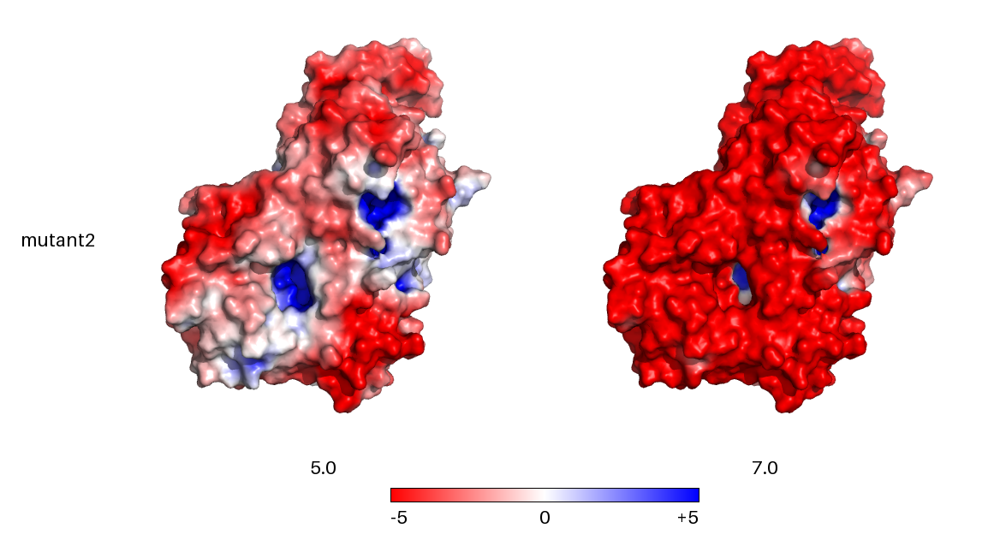

# pHmap

pHmap generates ordered maps of pH-dependent protein electrostatic surface
potential. Protein protonation is prepared with PDB2PQR/PROPKA, electrostatic
potential is calculated by APBS, surfaces are rendered by PyMOL, and the final
figure is composed in Python.



pHmap is a local Python application with a command-line interface, a browser
GUI, and a double-click desktop launcher. It supports PDB and PDBx/mmCIF files,
optional RCSB PDB downloads by structure ID (for example `3SQR`),
explicit pH values or an inclusive pH range, an optional validated PyMOL camera
view, deterministic rendering order, isolated run directories, and a JSON
provenance manifest.

Visit the [pHmap website](https://riccstick.github.io/pHmap/) for downloads,
tutorials, and project documentation.

The example above uses `example/mutant2.pdb` at pH 5.0 and 7.0 with
`example/set_view.txt` and `--background white`, generated by the current
Python workflow.

## Local quick start

The complete scientific workflow needs Python 3.11+, PDB2PQR 3.7.x, APBS
3.4.1, and PyMOL Open Source. On Apple Silicon macOS, the supported development
environment is described by `pixi.toml`:

```console
pixi install
pixi run doctor
pixi run test
```

Validate the repository's two-pH smoke input without launching scientific
programs:

```console
pixi run validate-smoke
```

Run the end-to-end smoke workflow:

```console
pixi run smoke
```

The equivalent direct command is:

```console
phmap run example/mutant2.pdb \
  --ph 5.0 \
  --ph 7.0 \
  --view example/set_view.txt
```

Every run is confined to its own directory:

```text
runs/<run-id>/
├── manifest.json
├── inputs/
├── work/<protein-id>/<ph>/
├── logs/<protein-id>/<ph>/
├── renders/<protein-id>/
└── output/pHmap.png
```

Without `--output-dir`, each invocation creates a unique timestamped run. An
existing run directory is never overwritten implicitly. Failed scientific
commands stop the workflow, preserve their logs, and mark the manifest as
failed.

See [the development guide](docs/development.md) for environment details,
baseline policy, and current limitations.

## Local graphical interface

For everyday use on this Mac, double-click **`dist/pHmap.app`** after building
the local launcher once. It starts pHmap and opens your browser without Terminal.
The launcher provides **Open interface**, **Show results**, **View log**, and
**Quit** controls. Quitting cancels unfinished GUI work but keeps saved results.

Build that launcher from this checkout:

```console
pixi run build-app --local-project
```

For other users, [desktop release builds](docs/releases.md) produce Mac apps,
Windows executables, and Linux executables. They include a launcher and Pixi;
first launch downloads the locked scientific environment automatically. Python,
Pixi, and the backends do not need to be installed manually. Internet is needed
for first-time setup, not for subsequent calculations.

If first-time setup fails behind a company VPN or HTTPS inspection, see the
[desktop troubleshooting guide](docs/releases.md#troubleshooting) for safe
certificate/proxy checks and the setup log location.

Start the browser interface from the repository root:

```console
pixi install
pixi run gui
```

This opens `http://127.0.0.1:8765`. Enter a PDB code and click **Add PDB entry**,
or add local `.pdb`, `.cif`, and `.mmcif` structures. Mix a fetched reference
with uploaded variants, edit their row labels and order, and select a pH range
or explicit values. Adding more files appends them to the existing comparison.
Optional camera and
ligand files and figure settings are available in the setup form. Validate the
selection or start a calculation; the interface shows live stage progress,
individual surfaces, logs, and the final PNG download.

The GUI queues one calculation at a time and can cancel queued or active runs.
History includes both GUI runs and CLI runs in the same `runs/` directory. Files
are processed locally, with no remote calculation services or scripts. Optional
structure fetching contacts the official RCSB archive; your variant files are
never sent there. Verified cached downloads can be reused offline.
Closing the browser tab does not stop calculations; stopping the GUI server
with Ctrl+C (or quitting the desktop launcher) cancels its unfinished jobs and
preserves their files and logs.

Use another port or run directory, or suppress automatic browser opening:

```console
pixi run phmap gui --port 9000 --runs-dir runs --no-browser
```

All existing command-line arguments remain available. For example, this creates
a three-protein grid for pH 3 through 8 while the GUI can display its saved run:

```console
pixi run phmap run example/protein.pdb example/mutant1.pdb example/mutant2.pdb \
  --ph-range 3 8 1 --view example/set_view.txt
```

Fetch a reference structure and compare local variants (replace the variant paths
with your files):

```console
pixi run phmap run --pdb-id 3SQR variant1.cif variant2.pdb --ph-range 3 8 1
```

Fetched entries come first, followed by local files. Repeat `--pdb-id` for more
archive entries. Downloads use PDBx/mmCIF and are cached in `runs/.structures`;
`--structure-cache-dir` changes that directory and `--refresh-structures` requests
fresh archive copies. Original mmCIF files are retained; the pinned scientific
backend uses an audited PDB intermediate with documented size/identifier limits.
See the [structure tutorial](docs/tutorial.md#pdbxmmcif-and-pdb-ids).

Advanced surface and ligand display options are available in the browser's
**Advanced surface & ligand rendering** section and in the CLI:

```console
pixi run phmap run example/mutant2.pdb --ph-range 3 8 1 \
  --surface-mode 1 --surface-solvent --no-surface-ramp-above-mode \
  --ligand-representation sticks
```

Defaults remain unchanged. Choose `sticks`, `lines`, `dots`, `spheres`, or `none`
for the extra HETATM representation. These are display controls, not ligand
parameterization; the shared MOL2 input remains experimental. See the
[rendering tutorial](docs/tutorial.md#advanced-surface-and-ligand-rendering).

The GUI's **Publication styling** section also exposes label size/color, margins,
row/column/label spacing, legend visibility, and display-only pH precision:

```console
pixi run phmap run example/mutant2.pdb --ph-range 3 8 1 \
  --font-size 32 --outer-margin 32 --column-gap 24 --row-gap 24 \
  --label-gap 20 --ph-label-precision 1
```

Use `--no-legend` to hide the shared legend. These controls style new runs;
editing an existing run without recalculation is a follow-up feature. See the
[publication styling guide](docs/tutorial.md#publication-styling).

## Python-only development

If compatible PDB2PQR, APBS, and PyMOL executables are already available on
`PATH`, the Python project can also be installed with uv:

```console
uv sync --group dev
uv run phmap doctor
uv run pytest
```

`uv` does not install the APBS or PyMOL native programs; use the Pixi
environment for the complete supported local toolchain.

## Current scope

The [GitHub Actions workflow](.github/workflows/desktop.yml) runs unit/integration
tests, lint, type checks, scientific smoke runs, and native builds on PR updates
and pushes to `main`/`master` that change application, test, build, or dependency
files. Documentation-only updates use lightweight checks and the separate website
build. Version tags always run the full pipeline and create a draft release only
after all four platform jobs pass. See the [release guide](docs/releases.md) for
the change classification and required merge checks.

Available in the current Python application:

- PDB/PDBx input validation, verified PDB-ID downloads, pH range/list,
  ligand-path, and 18-value camera validation;
- modern PDB2PQR, APBS, and headless PyMOL subprocess adapters;
- deterministic multi-protein/pH ordering;
- checked outputs, per-cell logs, tool-version capture, and input/output hashes;
- a Python-native PNG grid and potential legend;
- a local GUI with uploads, validation, a serial process queue, cancellation,
  live progress, CLI-compatible history, and result downloads;
- a double-click desktop launcher and tagged GitHub release builds; and
- unit and fake-backend integration tests that do not need the scientific tools.

Activity lollipops, advanced styling controls, interactive 3D camera editing,
and selective reruns remain planned work. The legacy Bash and Script Server
implementations have been removed; their missing features are tracked rather
than silently treated as implemented.

See the [feature parity and implementation roadmap](docs/feature-roadmap.md)
for the legacy option mapping, remaining feature descriptions, acceptance
criteria, suggested implementation order, and the cleanup record.

## Scientific reproducibility

The README example is an illustration, not an accepted numerical baseline.
Historical [surface](docs/reference/pHmap.png) and
[activity](docs/reference/pHmap-activity.png) figures and the
[activity input](docs/reference/activity-xydy.txt) are retained as references
for future features; they do not contain complete scientific provenance.

An accepted baseline should retain the environment lock, manifest, PQR files,
APBS inputs, DX maps, logs, tiles, and final figure. Review numerical artifacts
before tolerant visual comparison; matching historical pixels alone does not
establish scientific correctness.

## Citation

Breslmayr, E. (2021). *pHmap - A tool for automatized calculation and
visualization of protein surface charge pH-profiles* (Version v1.2). Zenodo.
<https://doi.org/10.5281/zenodo.4751499>

[](https://zenodo.org/badge/latestdoi/308921470)

## License

[MIT](LICENSE)
