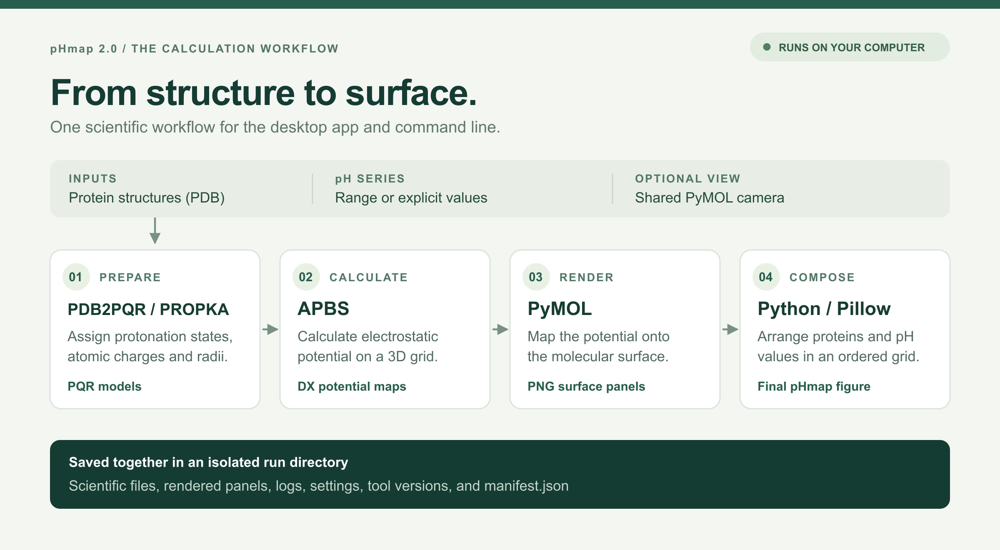
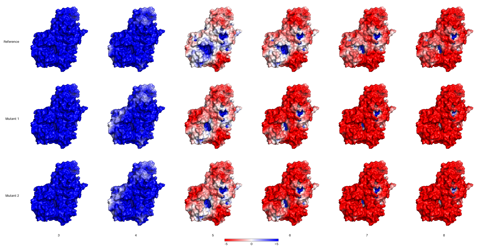

# pHmap 2.0: Exploring Protein Electrostatics Across pH—Now as a Local App

*Rebuilding a Bash tool in Python, with a graphical interface, desktop
launchers, and the command line still available.*

A protein surface map at pH 7 gives us one view of its electrostatic potential.
If our experiments cover a wider pH range, there is more to explore.

Changes in protonation can alter the electrostatic landscape around a protein.
Comparing those changes across pH values—and across related proteins or
variants—can help us formulate questions about binding, molecular recognition,
and enzyme behavior.

The practical challenge is producing those comparisons consistently. Each
structure and pH combination needs preparation, an electrostatics calculation,
rendering, and a place in the final figure.

In 2021, I introduced [the original pHmap tool](https://medium.com/@erikbreslmayr/multi-protein-ph-profile-surface-charge-maps-6937c1a2db1f),
which automated that process using Bash. It connected established scientific
programs and assembled their output into a protein-by-pH grid.

With pHmap 2.0, I have rebuilt the application in Python and added a local
graphical workflow. You can now start it through a desktop launcher, select
your structures in a browser interface, and follow the calculation without
entering a terminal command.


*Example generated with pHmap 2.0 at pH 5 and 7. Red indicates negative
electrostatic potential; blue indicates positive potential.*

## From a script to an application

The original workflow required users to install several scientific tools, make
them available on their system path, and become familiar with the command-line
arguments.

That approach was useful for scripting, but it created extra setup work for
anyone who mainly wanted to calculate and compare surfaces.

The new desktop launcher handles the scientific environment during its first
start. After that setup, it opens the pHmap interface in your browser.

The browser provides the interface; the calculations run on your computer.
Protein files and results stay local.

Desktop downloads target macOS, with separate Apple Silicon and Intel builds,
Windows x64, and Linux x64. The first launch requires an internet connection to
download the locked scientific environment. Subsequent calculations can run
offline once setup is complete.

The initial desktop builds are unsigned, so operating-system security warnings
may appear. The [download and release documentation](../downloads.md) explains
setup and current platform limitations.

## The scientific workflow

pHmap continues to build on established scientific software.

[PDB2PQR](https://pdb2pqr.readthedocs.io/en/latest/using/), using PROPKA for
titration-state assignment, prepares a PQR model for each requested pH.
[APBS](https://apbs.readthedocs.io/en/latest/) then calculates the electrostatic
potential using a continuum electrostatics model. PyMOL renders the potential
on the molecular surface, and Python assembles the resulting panels into the
final PNG figure.

The Python application coordinates these stages, validates inputs, checks their
outputs, and keeps the results organized.



*The same local calculation workflow powers the desktop app and command line.
Each run retains the scientific files as well as the final figure.*

It also replaces the previous ImageMagick-based figure assembly with a Python
compositor.

Although “surface charge maps” is a familiar description, the colors in these
figures represent calculated **electrostatic potential** on the molecular
surface. With the default color ramp, red indicates negative potential, white
is near zero, and blue indicates positive potential.

Using the same potential scale across panels makes the comparison easier to
interpret.

## A practical example: three proteins, pH 3 to 8

Suppose you want to compare a reference protein and two variants over pH 3–8.

In the graphical interface, the workflow is:

1. Add the three PDB files.
2. Give the proteins readable labels and arrange their row order.
3. Select a pH range with start `3`, stop `8`, and step `1`.
4. Choose the figure settings and, optionally, provide a PyMOL camera view.
5. Validate the inputs and start the calculation.

This requests six pH values—3, 4, 5, 6, 7, and 8—for each protein, producing 18
surface panels.

[](../assets/publish/phmap-three-proteins-ph3-8.png)

*Three example structures across pH 3–8. Rows identify the reference and two
variants; columns use the same camera view and potential scale. These are
calculated examples, not experimental activity measurements. Open the image
for the full-resolution figure; [figure provenance](../assets/publish/phmap-three-proteins-ph3-8.json)
records the inputs, settings, and tool versions.*

The interface shows calculation progress, individual renders, logs, and the
final figure. It also provides a run history, result downloads, and
cancellation controls.

For a meaningful visual comparison, prepare related structures in a common
coordinate frame and use a shared camera view. pHmap accepts an exported
18-number PyMOL view, allowing you to choose an orientation that exposes the
region you want to examine.

That preparation matters particularly when comparing a binding cleft or a
localized surface patch.

## The command line is still there

A graphical interface is convenient for exploring a dataset, while
command-line access remains useful for repeatable workflows.

Both interfaces use the same underlying calculation pipeline.

From a repository checkout with Pixi installed, the three-protein example can
be run with:

```bash
pixi install

pixi run phmap run \
  example/protein.pdb \
  example/mutant1.pdb \
  example/mutant2.pdb \
  --ph-range 3 8 1 \
  --view example/set_view.txt \
  --label "Reference" --label "Mutant 1" --label "Mutant 2" \
  --background white
```

You can also request individual pH values instead of a range. Existing users
should consult the current documentation when translating older Bash commands,
because the Python CLI uses updated argument names.

## Keeping more than the final image

The final figure is useful for inspection and communication, but the
calculation behind it also needs to remain accessible.

Each pHmap run gets its own directory containing the input copies,
intermediate scientific files, rendered panels, logs, and final image. A JSON
manifest records settings, executed commands, backend version information, and
file hashes.

This makes it easier to investigate a failed stage or revisit how a figure was
produced. Failed calculations retain their logs and available artifacts.

These records support reproducibility and review. They also give us more
useful evidence than comparing two rendered images alone, especially when
rendering can vary between software builds or operating systems.

## What a pH map can tell us

A series of electrostatic surfaces can reveal patterns worth investigating:
a patch that changes potential across the pH range, a difference between
variants, or a region that remains comparatively stable.

Those observations can guide hypotheses and experimental follow-up.

The figures still depend on the input structure, protonation assignment,
parameters, and electrostatics model. This workflow does not simulate
pH-induced unfolding or conformational dynamics, and a surface map alone
cannot establish an activity optimum or binding affinity.

For me, its value is making a consistent comparison accessible enough to
become a routine part of examining a protein.

## What comes next

The rewrite establishes the core local calculation workflow, desktop access,
and shared CLI and GUI.

Some capabilities from the earlier tool still need to return. Activity-data
overlays, including lollipop plots and uncertainty bars, remain planned work.
Editing a completed figure or changing its rendering without repeating the
scientific calculations is also on the roadmap.

Further plans include more publication styling controls, saved project
settings, optional PyMOL session export, and an interactive camera preview.

The [feature roadmap](../feature-roadmap.md) documents their status and the
remaining implementation work.

If you would like to try the new version, start with the
[pHmap website](../index.md) and its [tutorial](../tutorial.md), or download a
desktop build from [GitHub Releases](https://github.com/riccstick/pHmap/releases).

Try a pH series for one structure, then add a related protein or variant. I
would be interested to hear which comparisons are useful in your work—and
what would make the next version easier to use.
